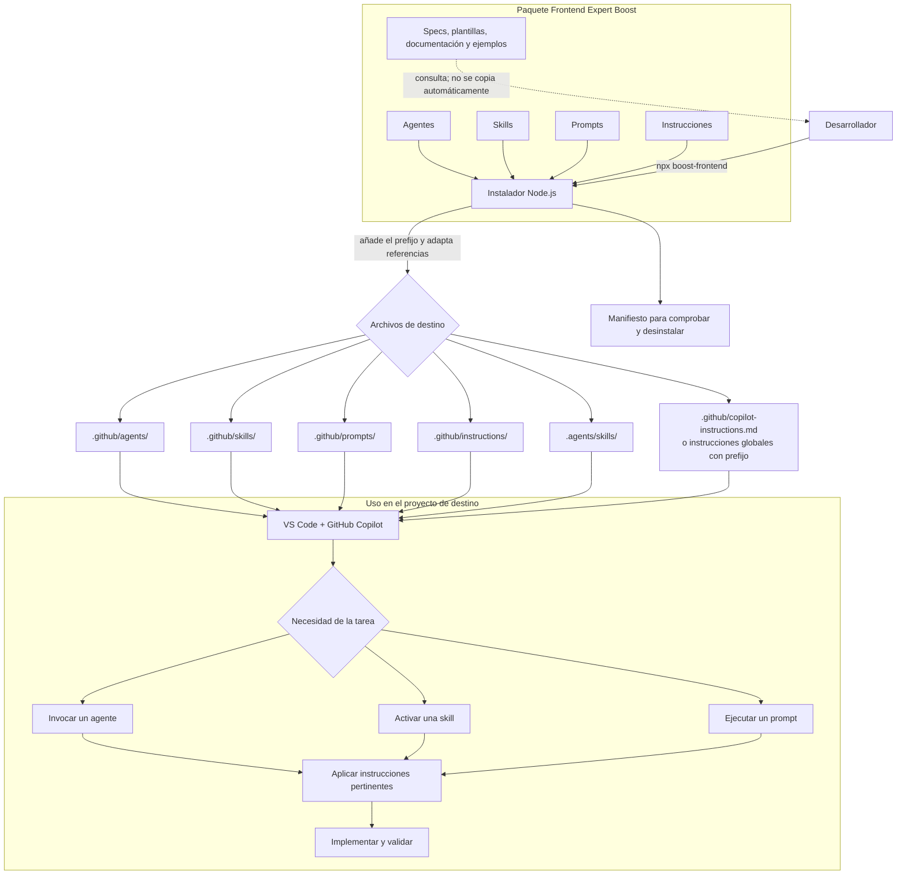

# Frontend Expert Boost

Convierte GitHub Copilot y sus agentes en un equipo frontend experto, orientado a producción: Angular, React, arquitectura, calidad, accesibilidad y rendimiento.

Paquete npm: `boost-frontend`.

## Qué incluye

| Carpeta | Contenido |
| --- | --- |
| `agents/` | 10 agentes especializados en arquitectura, Angular, React, microfrontends, pruebas, accesibilidad, rendimiento, sistemas de diseño, migraciones y revisión de código |
| `skills/` | 12 skills con checklists operativos reutilizables |
| `instructions/` | 13 conjuntos de instrucciones para GitHub Copilot |
| `prompts/` | 13 prompts listos para usar en VS Code |
| `specs/` | Contratos de calidad para arquitectura, seguridad, rendimiento, accesibilidad y observabilidad |
| `templates/` | Plantillas para componentes, pruebas, ADR, auditorías y planes |
| `docs/` | Modelo operativo, referencias oficiales y matrices de enrutado |
| `examples/` | Casos de uso y ejemplos de resultados |

## Requisitos y dependencias

Este repositorio es un paquete de recursos para agentes; no es una aplicación frontend ni una aplicación Next.js. No necesita instalar Angular, React, un servidor MCP ni dependencias de ejecución de terceros.

| Uso | Requisitos |
| --- | --- |
| Instalar el boost | Node.js 20 o posterior y npm/npx |
| Usar los recursos instalados | VS Code y GitHub Copilot |
| Ejecutar las comprobaciones | Node.js 20 o posterior |
| Crear una publicación | Las dependencias de desarrollo de `package.json` y la configuración de publicación del proyecto |

El instalador usa únicamente módulos integrados de Node.js (`node:fs`, `node:path` y `node:url`). No hay dependencias de producción (`dependencies`) en `package.json`.

Las dependencias de desarrollo se usan para automatizar las publicaciones; no son necesarias para instalar ni utilizar los agentes:

| Dependencia | Uso |
| --- | --- |
| `semantic-release` | Automatizar la publicación de versiones |
| `@semantic-release/changelog` | Actualizar el changelog durante la publicación |
| `@semantic-release/commit-analyzer` | Determinar la siguiente versión a partir de los commits |
| `@semantic-release/git` | Incluir los archivos de publicación generados en el proceso |
| `@semantic-release/github` | Crear la publicación en GitHub |
| `@semantic-release/npm` | Publicar el paquete en npm |
| `@semantic-release/release-notes-generator` | Generar las notas de publicación |
| `conventional-changelog-conventionalcommits` | Interpretar commits con el formato Conventional Commits |

## Instalación

El boost es autocontenido. No requiere instalar un runtime, un plugin ni un servidor MCP en el proyecto de destino.

Desde la raíz del proyecto donde quieras instalarlo:

```bash
# Obtener e instalar desde GitHub
npx github:Sertxito/boost_frontend

# O, si está publicado en npm
npx boost-frontend
```

Opciones disponibles:

| Opción | Descripción |
| --- | --- |
| `--target <dir>` | Instala en el directorio indicado; por defecto usa el directorio actual |
| `--force` | Sobrescribe archivos existentes |
| `--dry-run` | Muestra las acciones previstas sin escribir archivos |
| `--no-agents-dir` | No crea la copia adicional de las skills en `.agents/skills/` |
| `--check` | Comprueba que los archivos instalados según el manifiesto existan |
| `--uninstall` | Elimina los archivos registrados en el manifiesto de esta instalación |
| `--help` | Muestra la ayuda del instalador |

### Archivos instalados

| Recurso | Destino |
| --- | --- |
| Agentes | `.github/agents/frontend-*.agent.md` |
| Skills | `.github/skills/frontend-*/SKILL.md` |
| Copia adicional de las skills | `.agents/skills/frontend-*/SKILL.md` |
| Prompts | `.github/prompts/frontend-*.prompt.md` |
| Instrucciones | `.github/instructions/frontend-*.instructions.md` |
| Instrucciones globales | `.github/copilot-instructions.md`, si no existe ya |
| Manifiesto de instalación | `.github/.boost-boost-frontend.manifest.json` |

Las skills se copian también a `.agents/skills/` salvo que se indique `--no-agents-dir`. El instalador antepone `frontend-` a los nombres para evitar conflictos y adapta las referencias internas de los recursos instalados.

Los archivos preexistentes no se sobrescriben por defecto: se informa del conflicto y se omite el archivo. Usa `--force` para sobrescribir. Si el proyecto ya tiene `.github/copilot-instructions.md`, se conserva; las instrucciones globales del boost se guardan como `.github/instructions/frontend-global.instructions.md`.

El paquete también contiene `specs/`, `templates/`, `docs/`, `examples/` y `references/`. Se distribuyen con el paquete, pero el instalador no los copia al proyecto de destino.

### Verificar o desinstalar

```bash
npx boost-frontend --check
npx boost-frontend --uninstall
```

Después de instalar, recarga VS Code con `Developer: Reload Window`. Puedes comprobar que Copilot reconoce los recursos escribiendo `@` para agentes, `/` para prompts y abriendo el selector de skills.

## Cómo se conecta y cuál es el flujo

El catálogo del repositorio contiene los recursos fuente. El instalador selecciona los recursos compatibles, les añade el prefijo del boost, adapta sus referencias y los copia a las ubicaciones que VS Code y Copilot detectan. Las especificaciones y plantillas acompañan al paquete como material de consulta, pero no se instalan automáticamente.



## Inicio rápido

1. Abre el proyecto en VS Code e instala el boost.
2. Revisa las instrucciones globales de Copilot del proyecto.
3. Elige un prompt, una skill o un agente según la tarea.
4. Ajusta las especificaciones del paquete a tu stack antes de basar decisiones de producción en ellas.

## Agentes disponibles

| Agente | Cuándo usarlo |
| --- | --- |
| `FrontendPrincipalArchitect` | Arquitectura, límites entre módulos, microfrontends, estado y despliegue |
| `AngularExpertAgent` | Funcionalidades Angular: signals, standalone, carga diferida y vistas diferibles |
| `ReactExpertAgent` | Funcionalidades React: hooks, composición, Suspense y App Router |
| `FrontendCodeReviewAgent` | Revisiones de PR: severidad, riesgo residual y controles de calidad |
| `AccessibilityAuditorAgent` | Hallazgos WCAG AA y plan de remediación |
| `PerformanceAuditorAgent` | Core Web Vitals, tamaño del paquete, telemetría y observabilidad |
| `TestingStrategistAgent` | Estrategia de pruebas y controles de calidad para CI |
| `DesignSystemArchitectAgent` | Tokens, componentes base y gobernanza del sistema de diseño |
| `MicrofrontendArchitectAgent` | Federación y contratos entre host y remotos, con despliegue independiente |
| `FrontendMigrationModernizationAgent` | Migraciones incrementales sin reescritura completa |

Consulta la [matriz completa de enrutado](docs/operating-model.md#matriz-de-enrutado-de-agentes) y el [flujo de prompt a plantilla](docs/operating-model.md#playbook-prompt--template) en `docs/operating-model.md`.

## Filosofía

Producción primero. TypeScript estricto. Accesibilidad por defecto. Rendimiento medible. Arquitectura modular. Pruebas realistas. Registros de decisiones para cambios estructurales. Sin humo: si algo no encaja, el agente debe explicarlo.

## Comprobaciones

```bash
npm run evals   # ejecuta las evaluaciones de humo del boost
npm run quality # valida los metadatos JSON y ejecuta las evaluaciones
```

`npm run quality` es el control previo a la publicación: comprueba los metadatos y que los agentes, prompts, skills, especificaciones y casos de evaluación estén presentes y cumplan sus contratos mínimos.

## Personalización recomendada

- `specs/frontend-architecture.spec.md`: adapta la arquitectura y las restricciones del proyecto.
- `specs/design-system.spec.md`: documenta tokens y componentes.
- `specs/security-auth.spec.md`: adapta autenticación y seguridad al proveedor elegido.
- `templates/adr-template.md`: ajusta el formato de los registros de decisiones.

## Más información

- [docs/operating-model.md](docs/operating-model.md): modelo operativo, enrutado de agentes, flujo de trabajo y especificaciones.
- [docs/official-references.md](docs/official-references.md): fuentes oficiales de Angular, React, TypeScript, accesibilidad, rendimiento y seguridad.
- [examples/use-cases.md](examples/use-cases.md): ejemplos de prompts por escenario.
- [examples/skills-use-cases.md](examples/skills-use-cases.md): ejemplos de uso de las skills.

## Nombres y conflictos

Los recursos instalados usan el prefijo `frontend-` (por ejemplo, `.github/agents/frontend-<nombre>.agent.md` y `.github/skills/frontend-<nombre>/`) para que varios boosts puedan convivir en el mismo proyecto. También se adaptan sus referencias internas.

- Si un archivo ya existe en el destino, no se sobrescribe y se informa con `[WARN] ... already existed ... IGNORED`. Usa `--force` para reemplazarlo.
- Si ya existe `.github/copilot-instructions.md`, se conserva; las instrucciones globales del boost se instalan como `frontend-global.instructions.md`.
- Puedes volver a ejecutar el instalador sin sobrescribir archivos existentes. `--check` y `--uninstall` operan sobre el manifiesto de instalación.
